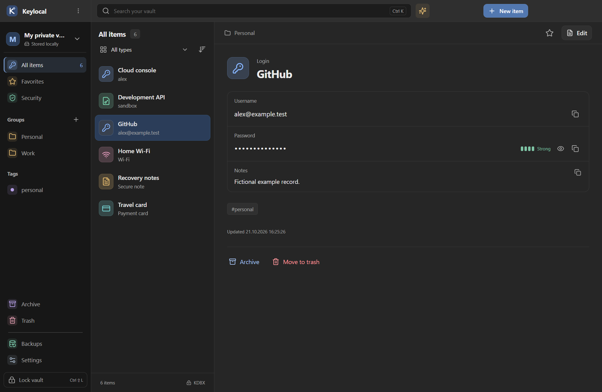
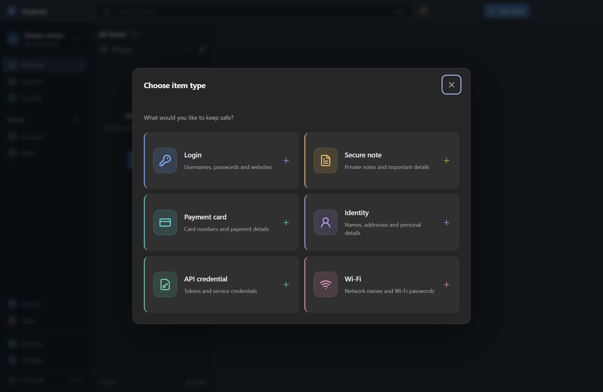
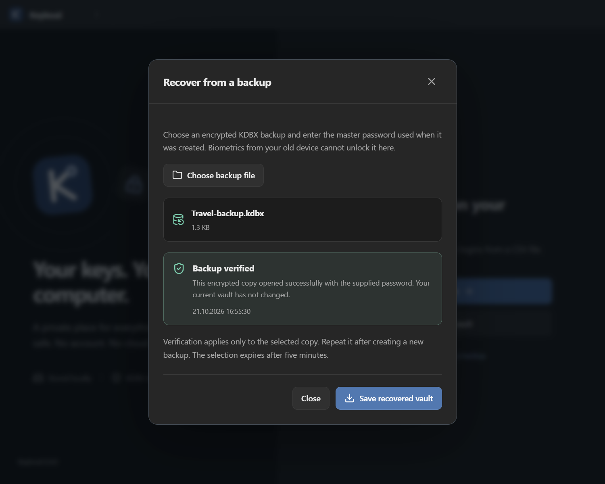

# Keylocal


An offline desktop password manager. Your logins, notes and other private details live in an encrypted file on your computer. There is no account to create and no server to run.



## Getting started

Keylocal is currently **0.4.2 alpha**. Windows x64 has been tested locally. macOS builds are configured, but still need testing on real Macs.

There is no published installer release yet. You can [build from source](#build-from-source), or generate unsigned Windows and Mac packages with the **Run workflow** button under [Actions](https://github.com/mrberkyavuz/keylocal/actions/workflows/build.yml). Completed runs provide downloadable build artifacts. Published installers will appear under [Releases](https://github.com/mrberkyavuz/keylocal/releases).

Once the app is open:

1. Create a vault and choose a long, memorable master password, or open an existing password-only KDBX vault.
2. Add a record or import an export file. Review the import preview before saving.
3. Choose a backup folder on a separate drive, make a backup and use **Verify a backup** to check that it opens.

Keep your master password somewhere safe. There is no password reset, and a fingerprint cannot replace it when moving to a new computer.

## Inside the app

- **Six record types:** logins, secure notes, payment cards, identities, API credentials and Wi-Fi networks. Each supports the fields it needs, plus custom fields.
- **Remembered vaults:** every vault you create or open stays in the scrollable vault list on both the home and unlock screens. Missing files stay listed with an unavailable indicator.
- **Organization:** groups, tags, favorites, search, sorting, archive and trash.
- **Password tools:** random passwords, memorable passphrases and local checks for weak or reused passwords.
- **Automatic locking:** idle timeout, computer lock and sleep. Copied secrets are cleared from the clipboard after a configurable timeout.
- **Backups and recovery:** previous encrypted versions, an optional external backup folder, password verification and recovery into a new file.
- **Import and export:** CSV and 1PUX import with a preview; encrypted KDBX export. Unsupported import fields are reported.
- **Appearance:** dark, light and system themes; English and Turkish.

All screenshots use fictional records.

<details>
<summary>See record types and backup recovery</summary>

### Choose what to save



### Check a backup before restoring it



</details>

## Where your data goes

Vault contents are stored in a portable `.kdbx` file. New vaults use KDBX 4.1 and Argon2id. Keylocal has no telemetry, background network requests or online account. Preferences such as recent file locations and the selected theme are stored locally outside the vault.

Windows Hello is available on compatible Windows 11 devices with WebAuthn PRF support. After setup, it is the preferred unlock option; the master password remains available. Windows controls whether fingerprint, face or PIN is offered. Touch ID integration is implemented for signed Mac builds, but has **not** been validated on physical hardware.

Keylocal has not had an independent security audit. Encryption protects a locked vault file; it cannot fully protect secrets on a computer compromised by malware. Clipboard managers may retain copied values after Keylocal clears the clipboard. See [SECURITY.md](SECURITY.md) for the protection model and its limits.

## Backups that can move with you

Before saving a change, Keylocal keeps the previous encrypted version. When an external backup folder is connected, it also saves the current encrypted copy there. It retains up to 20 local versions and 30 external copies.

The Backups page shows whether the destination is reachable and how many copies are present. **Verify a backup** checks a selected copy using its master password without changing your open vault. A reachable folder alone does not prove that its backups can be opened.

On a new computer, choose **Recover from a backup** on the first screen. Select the backup, enter the password used when it was created, then save the recovered vault as a new file. Existing files are never overwritten by this workflow. Device biometric credentials do not travel with the backup.

A backup on the same disk will not help if that disk fails. Older copies can contain deleted records and still use an older master password. Keep a separate copy and test recovery occasionally.

## Current limits

There is no browser autofill, mobile app, TOTP generator, attachment support or device synchronization yet. Do not edit the same active vault from multiple computers or place it in a shared sync folder for concurrent use. Key-file and hardware challenge-response vaults are not supported by the UI.

Alpha packages are unsigned. Windows signing, macOS signing/notarization and real Mac testing are required before a broader release. Planned work is tracked in [ROADMAP.md](ROADMAP.md).

## Build from source

Use Node.js 24 and npm. Run these commands in a terminal:

```sh
git clone https://github.com/mrberkyavuz/keylocal.git
cd keylocal
npm ci
npm test
npm run build
npm start
```

The app runs in Electron. Opening the interface in a regular browser will not provide vault access.

To create an installer on the matching operating system:

```sh
npm run pack:win  # Windows x64 installer
npm run pack:mac  # Apple Silicon and Intel DMGs
```

Packages are written to `release/`. See [RELEASING.md](docs/RELEASING.md) for signing and distribution requirements.

The latest local checks passed **50 Node tests** and **14 desktop smoke flows**, plus focused recovery and diagnostics checks. These are local Windows results, not a claim that every platform has been validated. Details are in [VERIFICATION.md](docs/VERIFICATION.md).

## Contributing and support

Mac testing, accessibility improvements and focused bug reports are welcome. [CONTRIBUTING.md](CONTRIBUTING.md) covers setup and the hardware test checklist. For a bug report, include the app version, operating system and steps to reproduce it. **Settings → Privacy** can preview and save a version-only diagnostics report; nothing is sent automatically.

Do not attach a real vault, password or unencrypted export to an issue. Follow [SECURITY.md](SECURITY.md) when reporting a suspected vulnerability.

[MIT License](LICENSE)
